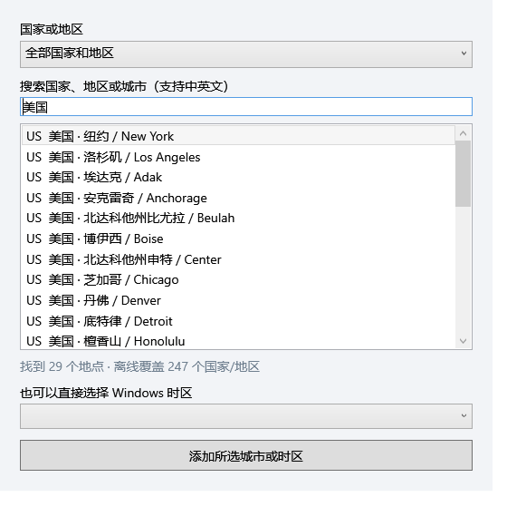

# Gravity WorldTime

**Magnetic world clocks for your Windows desktop.**

Stack city clocks, fold groups against a screen edge, and get a friendly hint about when to reach someone.

[Download 0.1.14](https://github.com/wbyhome/Gravity-WorldTime/releases/tag/v0.1.14) · [简体中文](README.zh-CN.md)


*Real WPF interface render in Simplified Chinese at a fixed example time: 04:26 in Los Angeles. The hint is an estimate, not a person's actual status.*

## Features

### New in 0.1.14

- **A simpler date column:** each clock shows its local month/day, with AM/PM in 12-hour mode. Yesterday/today/tomorrow labels and their date-column colors have been removed. Contact advice can still mention the next suitable day.
- **Optional Windows time-zone switching, added in 0.1.13:** right-click a city → **Set computer time zone** → review the preview → **Apply to Windows**. This changes the computer-wide time zone, not UTC or time synchronization. The original zone is saved for restoration; administrator retry is explicit. Real system changes and UAC have not yet been accepted in a physical test environment. [Usage and limits](docs/RELEASE-0.1.14.md)

This release is the **multi-row translucent magnetic clock** version. It does not include the later 0.2.x time-ruler previews.


*Actual 0.1.14 WPF control render with synthetic time and city data; not a private desktop capture.*

### Retained from 0.1.12

- **A routine for each city:** open the tray manager and choose **City routine** beside a city (also available from the clock's context menu). Disable the default schedule to set wake/sleep times, contact hours, an optional break and days off. Overnight contact windows belong to the day they start. Cancel leaves the saved routine unchanged; enable the default schedule to inherit global settings again. Hints remain estimates, not someone's real availability.
- **Desktop recovery:** retry native desktop attachment when the host disappears, without silently switching to pinned-on-top mode. Monitor snapshots help keep clock groups within a remaining display's work area when the display configuration changes.

The unchanged 0.1.14 download binaries passed 544 model/catalog checks, 791 programmatic WPF checks, 16 native-window checks and the layered-child rendering probe. The user's physical Win+D confirmation applies to 0.1.12 on the tested computer; it is not a new 0.1.14 physical acceptance result. Actual Explorer restart, sleep/resume and mixed-DPI monitor changes still need separate acceptance. See [0.1.14 validation](docs/RELEASE-0.1.14.md).

- **Magnetic groups:** move a stack or snap it to another group.
- **Split from a header:** drag a lower clock's left header to move that clock and everything below it.
- **Automatic edge folding:** release near a screen work-area edge to fold a group into a small tab; click to expand.
- **Desktop or pinned on top:** choose native desktop presentation or floating clocks above ordinary windows.
- **419 cities and places across 247 countries/regions**, searchable offline in four languages.
- **Friendly two-line hints:** a tentative life situation plus a contact suggestion or a destination-local time.
- **Translucent backgrounds with opaque text**, configurable opacity and hint size.
- **System-tray application entry**, with no taskbar button for every city.

This is a standalone Windows prototype, separate from the Gravity Desktop application.

## Download and start

1. Download the Windows x64 ZIP from [Releases](https://github.com/wbyhome/Gravity-WorldTime/releases/tag/v0.1.14).
2. Extract the entire ZIP to a writable folder. Keep the EXE and supporting files together.
3. Install **.NET 8 Desktop Runtime (x64)** if needed. The plain .NET runtime does not include WPF.
4. Run `Gravity.WorldTime.exe`. Click its system-tray icon to manage cities and settings.

The target environment is Windows 10/11 x64 with an interactive desktop. Compatibility with every Windows build is not certified. This is a framework-dependent portable prototype, not an installer or Microsoft Store package. A fresh start creates example clocks; the download contains no personal layout.

## Add cities

Click the tray icon → **Add city**. Filter by country/region or search English, Simplified Chinese, Traditional Chinese or Japanese names. Country codes and common aliases such as `US`, `USA`, `UK` also work. You can combine names (`United States New York`) or omit Latin accents (`Sao Paulo`).



*Isolated WPF interface render in Simplified Chinese. The catalog works offline.*

Multi-zone countries offer multiple places. This is not a complete list of every city. For an unlisted place, choose its Windows time zone directly and change the clock's display name.

Names and mappings derive from **Unicode CLDR 48.2**. Current offsets and daylight-saving transitions come from the installed Windows time-zone database. The 247 total includes countries, territories and regions, not only sovereign countries. [Provenance](docs/catalog-provenance.json) · [Third-party notices](THIRD_PARTY_NOTICES.md)

## Move, group and fold

| Action | Result |
| --- | --- |
| Drag the first clock | Move its whole stack |
| Drag a lower clock's left header | Split and move that clock and all clocks below |
| Drag a lower clock's main body | Do not split the group |
| Release near another compatible group | Snap together, when snapping is enabled |
| Release near a screen work-area edge | Fold automatically |
| Hold **Alt** on release | Cancel snapping and automatic folding for that drag |
| Click an edge tab | Expand its group |
| Right-click a clock or tab | Open its available actions |

Manual fold actions and **Expand all clocks** are also available. Folded state is remembered on restart. Expanding does not immediately fold the group again. A missing monitor makes edge tabs fall back to an available screen; clock order and saved layout are retained.

## Appearance and display modes

**On desktop** attaches small native alpha windows to Explorer's desktop host; WPF generates the clock images. **Pin on top** uses floating WPF windows. Switching modes recreates the presentation windows while retaining cities and groups.

**Recover clocks (pin on top)** expands clocks, brings their groups into the work area and selects top mode. It may adjust out-of-bounds positions.

Background opacity defaults to **35%** (65% transparent); text stays opaque. Settings support 15–100% background opacity, hint size, 12/24-hour time, magnetic snapping, life hints, contact advice, usual work/contact hours and a one-hour break.

English is the base language. Supported system languages are English, Simplified Chinese, Traditional Chinese and Japanese; others fall back to English. Manual language selection is available.

## A friend's perspective

The clock distinguishes the small hours, morning, afternoon, evening, night and late night. At 04:26 it suggests that a friend may be asleep. Meals, work, getting home and winding down get different wording. The second line gives a contact suggestion or an explicitly **destination-local** time based on the configured schedule.

These are general estimates. The app does not know someone's real activity, sleep, holidays or calendar. It has no presence service and requires no account or API key. Life hints and contact advice can be disabled independently.

## Data and updates

State is stored beside the EXE in `data/worldtime.json`; saving keeps a `.bak` generation. Use `--data-dir` to select another folder.

Exit before replacing program files. Preserve your existing `data` folder when updating; release ZIPs do not contain one. Removing a clock city does not delete desktop files.

## Build and check

Use a Windows x64 .NET SDK capable of targeting .NET 8:

```powershell
dotnet build .\src\WorldTime.csproj -c Release
.\src\bin\Release\net8.0-windows\Gravity.WorldTime.exe
```

For isolated model/catalog checks:

```powershell
New-Item -ItemType Directory -Force .\artifacts | Out-Null
Start-Process .\src\bin\Release\net8.0-windows\Gravity.WorldTime.exe -ArgumentList '--self-test --report artifacts/self-test.txt' -Wait
Get-Content .\artifacts\self-test.txt
```

`--ui-test`, `--layer-test` and `--layered-child-test` also take `--report <path>`. UI/native tests create temporary probe windows and require an interactive Windows session.

The generated catalog is included. To regenerate it on Windows with **PowerShell 7**, run `tools/Fetch-CatalogSources.ps1`, then `tools/Build-CityCatalog.ps1`. The fetch script pins CLDR release-48-2 and checks source hashes.

## Prototype status

Desktop visibility was confirmed locally. Actual Explorer restart, pointer-driven auto-fold/split/merge, mixed-DPI multi-monitor setups and Explorer restart recovery still need separate acceptance; they are not all marked passed.

Automated rendering and UI checks are limited evidence, not universal compatibility guarantees. [Validation notes](docs/VALIDATION.md)

Report reproducible problems through [Issues](https://github.com/wbyhome/Gravity-WorldTime/issues), with version, Windows build, display scaling and steps. Do not publish private layouts or desktop screenshots unintentionally.

## Source code and licensing

Copyright © 2026 Gravity Desktop. All rights reserved unless otherwise specified.

This publication makes prototype source visible; it does not add an open-source license. Unicode-derived data retains its separate terms. [Source and licensing](SOURCE_AND_LICENSING.md) · [Third-party notices](THIRD_PARTY_NOTICES.md)
