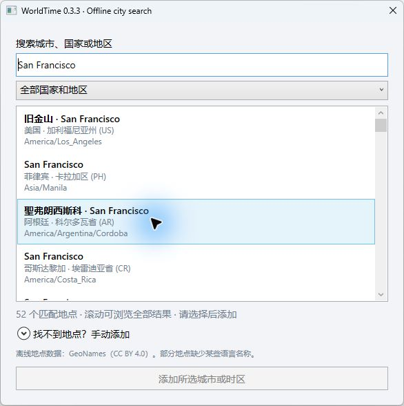
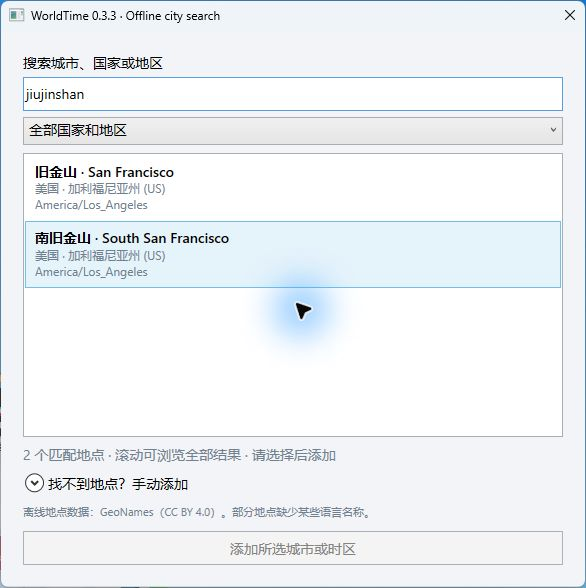

# Gravity WorldTime

**A world-time ruler and ring for your Windows desktop, with offline city search.**

Place friends and contacts at their local hour. Compare the shape of their day on a straight ruler or a circular 24-hour clock, with individual dates, avatars and routine-based illustrations. Version **0.3.3** adds **69,970 populated places** and multilingual offline search.

[Download 0.3.3 preview](https://github.com/wbyhome/Gravity-WorldTime/releases/tag/v0.3.3) · [简体中文](README.zh-CN.md) · [Multi-row clocks](docs/CLASSIC-CLOCKS.md)

This is the preserved **0.3.3 prerelease**, not the later 0.3.3.1 hotfix or 0.3.5 memory-optimized installer. Read the version-specific limits below.

*Actual 0.2.8 product-rendered illustration with synthetic people; these ruler visuals carry forward into 0.3.3. It is not an OS screen recording or live presence detection.*

## Two ways to see the day

- **Straight ruler:** people sit along their local hour, with nearby dates and grouping when people overlap.
- **Circular clock:** use the same people and time-zone rules around a 24-hour ring. Right-click → Display mode switches views. Each mode remembers its own position and size.
- **Adjustable ring:** drag the resize arrow/grip or use the ring-size menu. The current user’s marker is kept distinct from nearby contacts.
- **Desktop residence or pin on top:** stay on the Explorer desktop, or pin above ordinary windows. The tray provides management and recovery controls.
- **Personal routines and avatars:** choose an avatar, edit display names and set individual routines; use 12- or 24-hour time and four interface languages: English, Simplified Chinese, Traditional Chinese and Japanese.
- **Quiet motion or a still desktop:** stars, glow, clouds and small routine illustrations; Dynamic, Low motion or Completely static modes. Optionally follow Windows’ animation preference.

The ruler and ring represent daily clock cycles, not a single global chronological timeline. Sky colors are generic ambience, not live weather. Life illustrations estimate routines, not anyone’s measured activity or availability.

## Search for a city in your own words

The embedded GeoNames subset contains 69,970 places across 245 country/region codes. Search city names, partial names, supplied aliases, untoned pinyin and initials, or names in other scripts where the source data includes them. The search language is independent of the four UI languages; name translations are not complete.

Examples: **旧金山**, **San Francisco**, **jiujinshan**, **Tokyo**, **东京**, **São Paulo** and **Sao Paulo**. A country filter narrows ambiguous matches. Candidates show their country, administrative region and IANA zone; select the correct city before adding it. Results can include several different cities with the same name.

*Real final-build search window, synthetic profile. Pointer glow is from the capture tool; it does not indicate that a city is selected.*

*Real 0.3.3 search-component screenshot; see [media provenance](media/city-0.3.3/PROVENANCE.md) for build attribution.*

The search uses bundled data and Windows time-zone rules, not a paid AI or online geocoder. Stable place IDs and IANA identities are saved alongside Windows zone mappings. Daylight-saving changes use the installed Windows rules, not a fixed UTC offset. Data and Windows mappings can be incomplete or outdated; manual city/time-zone selection remains available. Older saved places are not silently deleted or renamed to match the new catalog.

**0.3.3 does not parse arbitrary full addresses.** Use a city name such as `旧金山` and the country filter. The concatenated address `美国加利福尼亚州旧金山` is not supported by this original build; the later 0.3.3.1 natural-address hotfix is not included here.

## Download and start

1. Download **Gravity-WorldTime-v0.3.3-win-x64.zip** from the [0.3.3 release](https://github.com/wbyhome/Gravity-WorldTime/releases/tag/v0.3.3).
2. Extract every file into a **new writable folder**. Keep the ZIP’s license and supporting files together.
3. Install **.NET 8 Desktop Runtime x64, including WPF**, if it is missing. Target: Windows 10/11 x64 with an interactive Explorer desktop; not every Windows configuration is certified.
4. Double-click **Start-WorldTime-Ruler.cmd**. It supplies `--ruler-desktop` and uses a separate `ruler-preview-data` folder beside the application.
5. Right-click → Add contact, search for a city, select the correct candidate, enter a display name and add it. Switch between ruler and ring from Display mode.
6. Use the tray or ruler menu to exit before backing up or updating.

The plain EXE without the launcher still starts the classic mode. This is a framework-dependent portable preview, **not an installer or Store package**. It does not update an installed newer WorldTime. The download contains no personal profile or PDB. Verify it with `SHA256SUMS.txt`.

## Everyday controls

| Action | Control in 0.3.3 |
|---|---|
| Move the straight ruler | Drag its embedded left grip |
| Change view | Right-click → Display mode |
| Resize the ruler / ring | Use its resize control or size menu |
| Add or edit contacts | Ruler context menu, person details or tray management |
| Change avatar or individual routine | Person editing controls |
| Rename yourself | More settings → My display name |
| Change transparency | Right-click → Adjust transparency |
| Motion | More settings → Animation effects |
| Float above ordinary windows | Pin on top; uncheck to return to the desktop |
| Recover an off-screen view | Reset position / tray recovery controls |

Full-body dragging and the simplified contact-adding flow arrived in 0.3.3.1. About/version dialogs, enlarged avatars and explicit two-person comparison arrived later; they are not 0.3.3 features. To identify this original build, check the file details of `Gravity.WorldTime.dll`: File version **0.3.3.0**.

## Profiles and updating

This preview uses `ruler-preview-data`, separately from classic `data` and newer installed-app user data. Exit the old app and back up its complete profile first. Extract into a new folder; no automatic migration is performed. Only copy a compatible **whole marked ruler profile** while both apps are closed. Do not replace a newer installed version or copy newer data backwards into this historical preview. Imported avatar copies belong to the profile; do not publish that directory.

Adding/removing contacts does not organize or delete desktop files. The classic manager has optional system-wide Windows time-zone actions; viewing world clocks does not require them. They are not network UTC synchronization; 0.3.3 has no later calibration service.

## Validation and known limits

The original reviewed 0.3.3 DLL/EXE are packaged unchanged. Compiler input checks cover **74 C# documents and three embedded resources**. Original checks passed: 78 city/search, 544 model/catalog, 1415 programmatic WPF and 455 ring/usability checks. User confirmation covers Chinese IME submission without accidental adding; a later original-build recheck found `旧金山` in the actual native route. These results do not certify every desktop or IME.

- First city-index load was around two seconds on the tested computer. The search cache stays in memory after the window closes in this version, and memory use can be substantial. Later memory optimizations are not included.
- Multilingual aliases, initials and pinyin depend on source coverage; they are not universal translation or typo correction.
- Physical network-disconnected testing, Japanese IME, low-end machines, long-duration behavior, Explorer restart, mixed-DPI/multi-monitor changes and sleep/resume acceptance remain incomplete.
- 0.3.3’s complete Win+D/pin/transparency human matrix was not rerun at its original handoff. Earlier/later version confirmations are not substituted for it.

[Version evidence](docs/RELEASE-0.3.3.md) · [Data provenance](src/Data/places033-provenance.json) · [Earlier ruler guide](docs/TIME-RULER-0.2.8.md) · [Classic multi-row 0.1.14](https://github.com/wbyhome/Gravity-WorldTime/releases/tag/v0.1.14)

## Build and rights

Use a Windows .NET SDK capable of targeting .NET 8: `dotnet build .\src\WorldTime.csproj -c Release`; launch the resulting EXE with `--ruler-desktop` for ruler/ring mode. The released binaries are the original frozen build, not a rebuild from this publication commit.

[Source code and licensing](SOURCE_AND_LICENSING.md) · [Third-party notices](THIRD_PARTY_NOTICES.md). GeoNames-derived data retains CC BY 4.0 terms; Unicode and IANA material retains its own notices. Source visibility grants no additional application license.

Copyright © 2026 Gravity Desktop. All rights reserved unless otherwise specified.

**Packaging recheck on 2026-10-29:** the 544 logic and 78 city/search checks passed. The ring suite stopped after 441 passed assertions because the exact opaque-amber-pixel assertion at background opacity 0 failed on this machine. The original handoff recorded 455 passes. This difference is unresolved, not counted as a new pass; use the ring-size menu if the grip is difficult to see. The original binary is preserved.
