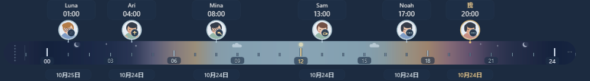

# Gravity WorldTime

**一把安静而有生命感的 Windows 桌面世界时间尺。**

不同地方的人，正过着一天里的哪段时光？每个人停在自己的当地小时位置，旁边有个人日期和基于作息的小情境。星星缓慢明暗、日月柔光、云朵轻移，仍然只是一条紧凑的桌面尺子。

[下载 0.2.8 时间尺预览版](https://github.com/wbyhome/Gravity-WorldTime/releases/tag/v0.2.8) · [English](TIME-RULER-0.2.8.md) · [旧版多条磁吸时钟](CLASSIC-CLOCKS.zh-CN.md)


*使用合成联系人和固定示例时间，由实际 WPF 产品代码直接渲染。深色衬底是展示背景，不是用户桌面；这不是系统录屏。人物状态只表示作息推测。*

## 同一把尺子，不同的一天

不用逐条对照多个时钟，可以沿着尺子比较每个人的当地时间。有人在凌晨四点，另一个人可能正在过下午。每个代表人物旁边都有自己的日期，跨日也能分清；时间接近的人可以聚合，打开分组查看各人的详细信息。

中间刻度表示一天内的时钟循环，**不是一条全球绝对时间线**。两端重复小时是为了视觉连续。渐变与天空只是通用氛围，不是实时天气，也不代表某个人实际的日照长度。

## 0.2.8 新增什么

- **轻量自然动画**：星星错开明暗节奏，日月柔和发光，云朵只在尺内缓慢移动。
- **基于作息的人物情境**：起床、晨间准备、日常活动、休息与睡眠。预设卡通增加小动作；导入照片保持原样，只附加小标记。
- **自定义名字**：联系人和“我”的显示名可单独修改，不改变城市、时区、头像或作息。
- **三种动态模式**：动态、低动态、完全静态；可跟随 Windows 动画偏好，明确选择动态仅在本应用内覆盖跟随行为。
- **保留紧凑桌面尺**：桌面驻留、可选置顶、半透明背景、调整宽度、人物详情、头像、个人作息和近邻聚合。
- **四语言与两种时间制**：英语、简体中文、繁体中文、日语；支持 12/24 小时制。



### 小动作，不是活动监控

| 起床 | 晨间准备 | 睡眠 |
|---|---|---|
|  |  |  |

*真实渲染局部的放大展示；实际程序中的头像仍然很小。*

设置起床后的前 30 分钟表现为起床，接下来一小时是晨间准备。明确设置的休息段与入睡前一段时间可以表现为休息。睡眠判断优先，因此夜班朋友白天睡觉也按个人作息处理。其余清醒时间使用中性的日常活动。**方便联系时段不等于工作时间。** 程序不检测在线状态、真实活动、日历或实际睡眠。

## 下载与启动时间尺

1. 在 [0.2.8 预发布页面](https://github.com/wbyhome/Gravity-WorldTime/releases/tag/v0.2.8) 下载 `Gravity-WorldTime-v0.2.8-win-x64.zip`。
2. 完整解压到新的可写文件夹。
3. 如尚未安装，安装 **.NET 8 Desktop Runtime x64（含 WPF）**。目标环境为 Windows 10/11 x64 和交互式 Explorer 桌面，并未认证所有 Windows 构建。
4. 双击 **`Start-WorldTime-Ruler.cmd`**。它运行 `Gravity.WorldTime.exe --ruler-desktop`，并创建独立的 `ruler-preview-data` 配置目录。
5. 右键时间尺添加联系人或修改外观；托盘图标提供管理与退出入口。

EXE 和配套文件必须放在一起。这是依赖运行库的便携原型，不是安装程序或 Store 包。直接运行不带 `--ruler-desktop` 的 EXE 仍进入经典多条模式，**本版本请使用附带的启动脚本**。下载包不含个人配置或 PDB；可用发布页的 `SHA256SUMS.txt` 核对 ZIP。

## 常用操作

| 操作 | 入口 |
|---|---|
| 移动时间尺 | 拖动左端内嵌把手 |
| 调整宽度 | 拖动右端，或右键 → 显示尺寸 |
| 添加人物 | 右键 → 添加联系人，选择城市或时区及显示名 |
| 查看个人详情 | 点击人物或聚合组 |
| 联系人改名 | 人物菜单/详情 → 联系人名称 |
| 给“我”改名 | 更多设置 → 我的显示名称… |
| 修改头像或作息 | 人物编辑入口及原有作息编辑器 |
| 调整透明度 | 右键 → 调整透明度… |
| 调整动画 | 更多设置 → 动画效果 |
| 浮在普通窗口上 | 右键 → 固定最上层；取消后回到桌面 |
| 找回位置 | 右键 → 重置时间尺位置 |

离线城市库覆盖 247 个国家/地区的 419 个地点。名称源自 CLDR，当前时差与夏令时使用 Windows 时区数据库。[地点来源](catalog-provenance.json) · [自然信息的依据与限制](NATURE-DATA-0.2.1.md)。已知坐标是参考城市坐标，不是用户位置。

### 想安静一些？

低动态保留静态生活标记；完全静态保留时钟和日期，移除动态装饰与生活徽章。两者都停止动画定时器。菜单、设置窗和隐藏状态也会暂停动画。跟随 Windows 且系统关闭动画时，动态实际降为低动态；明确选择动态会关闭本应用的跟随选项，不修改系统设置。


## 更新与个人数据

时间尺使用程序旁的 `ruler-preview-data`，与经典模式的 `data` 分离。联系人、尺子设置及导入头像副本保存在该目录。备份或替换前先退出程序。建议将本预览版解压到新目录，旧版 0.1.x 和 0.2.x 不会自动迁移或覆盖。如需沿用时间尺配置，先备份，在两个程序都退出后复制**整个带标记的时间尺配置目录**；不要将经典配置作为时间尺数据。

添加/移除联系人不整理或删除桌面文件。经典管理界面仍包含可选的电脑时区修改，这是明确的系统级操作，不是查看世界时钟的前提；真实系统时区修改与 UAC 验收仍单独保留。

## 验证与已知限制

发布的 DLL 和 EXE 就是本地审阅通过的文件，没有重新编译。64 个 C# 编译输入与原 Portable PDB 校验值一致，两个内嵌数据资源也与公开源码一致。最终构建通过 104 项时间尺专项、68 项信息层、216 项自然/日期、544 项逻辑、1243 项 WPF/本地化和 22 项自有原生宿主检查。用户在受测电脑按 Win+D 后确认：**稳定，能看到小动作**。

这不等于所有 Windows 配置的兼容认证。长期运行、Explorer 重启、睡眠唤醒、多屏热插拔和混合 DPI 物理验收尚不完整。100 联系人的资源样本实际聚合为 6 个可见代表，不是 100 个独立运动头像。静态内容虽缓存，原生窗口仍上传整张位图。

[版本证据与限制](RELEASE-0.2.8.md) · [编译输入校验](evidence-0.2.8/compiler-source-check.json) · [媒体来源](../media/ruler-0.2.8/PROVENANCE.md)

## 旧版多条半透明磁吸时钟

需要纵向堆叠、磁吸分组、拖动下方头部分拆和自动贴边折叠？保留的 [0.1.14 下载](https://github.com/wbyhome/Gravity-WorldTime/releases/tag/v0.1.14) 与[完整中文指南](CLASSIC-CLOCKS.zh-CN.md)、[英文指南](CLASSIC-CLOCKS.md)仍可访问。这些是经典模式功能，不表示时间尺也采用同一套行分拆/折叠交互。

## 从源码构建

使用能面向 .NET 8 构建的 Windows x64 .NET SDK：

```powershell
dotnet build .\src\WorldTime.csproj -c Release
.\src\bin\Release\net8.0-windows\Gravity.WorldTime.exe --ruler-desktop
```

WorldTime 是独立原型，与 Gravity Desktop 主程序分开。[源码与许可](../SOURCE_AND_LICENSING.md) · [第三方声明](../THIRD_PARTY_NOTICES.md)

Copyright © 2026 Gravity Desktop. 除另有说明外，保留所有权利；本次未新增开源许可。
